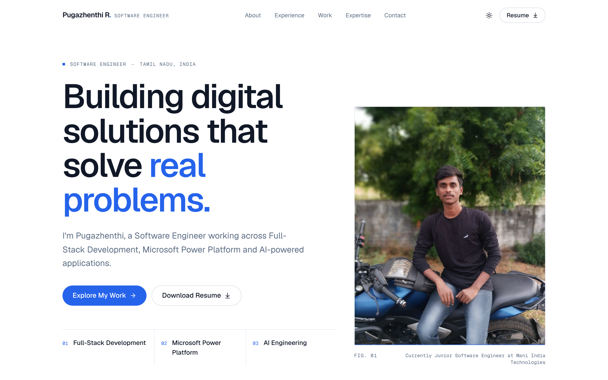

# Pugazhenthi R — Portfolio & Private CMS

A production-ready personal portfolio for **Pugazhenthi R, Software Engineer** (full-stack development, Microsoft Power Platform, AI engineering), with a private content-management dashboard at `/admin`.

- **Public site:** editorial, light-first design with an elegant dark mode, case-study pages, resume download, a working contact form, SEO and Open Graph images.
- **Private CMS (`/admin`):** manage projects (with draft, preview and publish), experience, skills, education, certifications, profile, photo, resume, media and contact messages. **Content changes go live without a redeploy.**
- **Security:** Supabase Auth with no public sign-up, a three-layer admin check (proxy → server → Postgres Row Level Security), and no service-role key anywhere in the app.



| | |
|---|---|
| Framework | Next.js 16 (App Router, Turbopack) · React 19 · TypeScript |
| Styling | Tailwind CSS 4 · Geist Sans / Geist Mono · shadcn-style primitives |
| Animation | Motion for React (plus CSS for the hero, so the LCP paints before hydration) |
| Data | Supabase Postgres · Supabase Auth · Supabase Storage |
| Forms | React Hook Form + Zod (the same schemas run in the browser and on the server) |
| Icons | Lucide React |
| Hosting | Vercel (Hobby) · GitHub |

---

## Quick start (local)

```bash
npm install
cp .env.example .env.local     # fill in values, or leave Supabase empty for seed mode
npm run dev                    # http://localhost:3000
```

**Seed mode (no Supabase).** If the Supabase variables are empty, the public site renders from the typed seed data in `src/content/seed.ts`. The contact form honestly reports that it isn't connected, and `/admin` shows setup instructions. This lets you preview and deploy the site before the database exists.

**Full mode.** Follow [`docs/SUPABASE.md`](docs/SUPABASE.md) to create the project, run the migrations, seed the content and create your admin account.

## Scripts

| Command | What it does |
|---|---|
| `npm run dev` | Development server |
| `npm run build` / `npm start` | Production build / serve |
| `npm run typecheck` | Generate route types and run `tsc` |
| `npm test` | Unit tests: validation, utilities, seed integrity (`node --test`) |
| `npm run test:db` | RLS and constraint suite against a real Postgres (44 checks) |
| `npm run test:e2e` | Full browser test of the site and CMS (33 scenarios) |
| `npm run test:a11y` | axe-core WCAG 2.1 AA audit in light and dark modes, plus overflow checks at 6 widths |
| `npm run db:seed-sql` | Regenerate `supabase/seed.sql` from `src/content/seed.ts` |

See [`docs/TESTING.md`](docs/TESTING.md) for what each suite covers and the latest results.

## Environment variables

| Variable | Required | Notes |
|---|---|---|
| `NEXT_PUBLIC_SITE_URL` | yes (prod) | Canonical URL, e.g. `https://pugazhenthi.dev`. Used for metadata, sitemap and OG. |
| `NEXT_PUBLIC_SUPABASE_URL` | for CMS | Supabase → Project Settings → API |
| `NEXT_PUBLIC_SUPABASE_ANON_KEY` | for CMS | The anon/publishable key. It's safe in the browser because RLS enforces access. |
| `CRON_SECRET` | optional | Protects `/api/keepalive`, the daily ping that stops the free Supabase project from pausing |

The **service-role key is not used** and must never be added.

## Project structure

```
src/
  app/
    (site)/               public pages: home, /projects, /projects/[slug]
    admin/login/          sign-in page (not linked from the public site)
    admin/(cms)/          protected CMS pages (layout re-verifies the admin)
    api/keepalive/        daily Supabase keep-alive (Vercel Cron)
    resume/               stable /resume link → redirects to the active PDF
    sitemap.ts robots.ts opengraph-image.tsx icon.svg not-found.tsx
  components/
    home/ project/ site/  public UI
    admin/                CMS UI (entity manager, forms, media, inbox…)
  content/seed.ts         initial content + seed-mode data layer
  lib/
    content/repository.ts public data access (cached, tag-invalidated)
    actions/              server actions (admin CRUD, contact form, auth)
    validation/           Zod schemas shared by client and server
    supabase/             server, browser and public clients
    auth.ts               getAdmin / requireAdmin*
  proxy.ts                session refresh + first gate for /admin
supabase/
  migrations/             schema, RLS, storage (run in order)
  seed.sql                generated initial content
tests/  unit/ db/ e2e/
docs/   ARCHITECTURE · SUPABASE · ADMIN · DEPLOYMENT · TESTING · ASSETS
```

## Documentation

- [Architecture, security model and database schema](docs/ARCHITECTURE.md)
- [Supabase setup, including Free-plan limits](docs/SUPABASE.md)
- [Admin account setup and using the CMS](docs/ADMIN.md)
- [Deploying to Vercel](docs/DEPLOYMENT.md)
- [Testing](docs/TESTING.md)
- [Assets, placeholders and content to review](docs/ASSETS.md)
